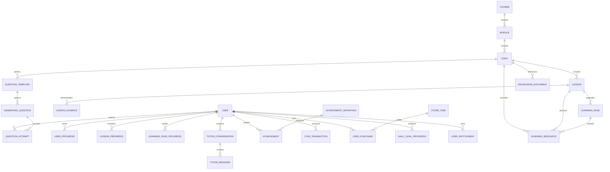
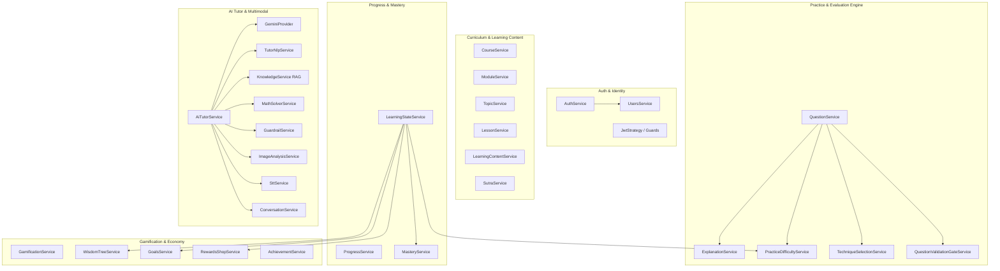
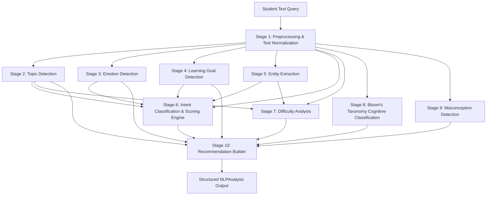

# DWANDA / VEDICMIND — MAJOR PROJECT SYSTEM ARCHITECTURE & TECHNICAL SPECIFICATION

**Project Title:** Vedic Mathematics Adaptive Learning Platform & Intelligent AI Tutor  
**Platform Names:** Dwanda / VedicMind  
**Academic Document Type:** Comprehensive Project & Technical Architecture Specification  
**Version:** 2.0 (Production Architecture)  
**Date:** March 2026  

---

## TABLE OF CONTENTS
1. [Project Overview & Objectives](#1-project-overview--objectives)
2. [Complete Technology Stack](#2-complete-technology-stack)
3. [Models Used in the System](#3-models-used-in-the-system)
4. [Database Architecture & Data Models](#4-database-architecture--data-models)
5. [System Services & Component Deep Dive](#5-system-services--component-deep-dive)
6. [Comprehensive REST API Reference](#6-comprehensive-rest-api-reference)
7. [End-to-End System Workflows](#7-end-to-end-system-workflows)
8. [10-Stage NLP Pipeline Architecture](#8-10-stage-nlp-pipeline-architecture)
9. [Vedic Mathematics Curriculum & Pedagogical Foundation](#9-vedic-mathematics-curriculum--pedagogical-foundation)
10. [Security, Guardrails & Production Hardening](#10-security-guardrails--production-hardening)

---

## 1. PROJECT OVERVIEW & OBJECTIVES

### 1.1 Executive Summary
**Dwanda (branded as VedicMind)** is an enterprise-grade, full-stack adaptive learning platform and multimodal intelligent tutoring system designed to teach and master **Vedic Mathematics** (the ancient Indian mathematical calculation system comprising 16 primary Sutras and 13 Sub-sutras / Upa-sutras).

The platform addresses a fundamental pedagogical gap: traditional mathematical education often emphasizes rote computational repetition rather than flexible mental agility and pattern recognition. Vedic Mathematics provides lightning-fast mental arithmetic shortcuts, cross-multiplication methods, algebraic factoring tricks, and modular arithmetic techniques. However, without personalized guidance, students struggle to identify which Sutra applies to a given problem and where common procedural mistakes occur.

### 1.2 Core Objectives
- **Interactive Multi-Page Curriculum:** Structured curriculum hierarchy (`Course → Module → Topic → Lesson → Learning Page → Worked Examples → Resources`) covering 10 modular units from foundations to advanced roots and calculus.
- **Dynamic Question Engine:** Procedural generation of mental math questions tailored to specific Sutras and difficulty tiers (Easy, Medium, Advanced, Expert) with step-by-step Vedic explanations.
- **Multimodal AI Tutor:** An intelligent tutor driven by Large Language Models (LLMs) with multimodal capabilities:
  - Text-based dialogue with Socratic guidance.
  - Image recognition for handwritten or printed math problems with domain guardrails.
  - Voice Speech-to-Text (STT) audio transcription with Vedic phonetic normalization.
  - Text-to-Speech (TTS) with math-aware symbol and emoji phonetic translation.
- **Deterministic Math Verification:** Non-eval Abstract Syntax Tree (AST) mathematical parser that eliminates LLM calculation hallucinations.
- **10-Stage Deterministic NLP Engine:** A modular, high-speed Natural Language Processing pipeline that analyzes student queries for intent, emotion, cognitive depth (Bloom's Taxonomy), learning goals, mathematical entities, and misconceptions without requiring external cloud inference.
- **Adaptive Mastery & Progression:** Dynamic mastery scoring based on weighted moving averages of accuracy, speed, and difficulty tiers, triggering automatic topic recommendations.
- **Holistic Gamification:** Pedagogically aligned motivation system featuring XP, Leveling, Continuous Daily Streaks, Coins, Stars, Wisdom Stones, interactive Wisdom Tree progression, Daily Goals, Weekly Missions, and a Rewards Shop for pedagogical hint/solution tokens.

---

## 2. COMPLETE TECHNOLOGY STACK

The system follows a modern decoupled client-server architecture:

```
┌─────────────────────────────────────────────────────────────┐
│                       CLIENT TIER                           │
│     React 18 + TypeScript + Vite + Tailwind CSS             │
│  Radix UI + Lucide Icons + Recharts + KaTeX + Web Speech    │
└──────────────────────────────┬──────────────────────────────┘
                               │ HTTP / REST (JWT)
                               ▼
┌─────────────────────────────────────────────────────────────┐
│                       SERVER TIER                           │
│              NestJS 11 + Express + TypeScript               │
│  Controllers, Services, Guards, Interceptors, Pipes, DTOs   │
├──────────────────────────────┬──────────────────────────────┤
│       AI / MULTIMODAL        │       NLP PIPELINE           │
│   Google Gemini 2.5 Flash    │   10-Stage Modular NLP       │
│   Whisper API / STT Engine   │   Fuzzy Levenshtein Matcher  │
│   Math AST Safe Parser       │   Pedagogical Scoring Engine │
├──────────────────────────────┴──────────────────────────────┤
│                   DATA ACCESS LAYER                         │
│             Prisma ORM 6.10 (Client & Engine)               │
└──────────────────────────────┬──────────────────────────────┘
                               │ TCP / Connection Pooling
                               ▼
┌─────────────────────────────────────────────────────────────┐
│                      DATABASE TIER                          │
│               PostgreSQL Relational Database                │
│         20+ Models, Foreign Keys, Indexes, Cascades         │
└─────────────────────────────────────────────────────────────┘
```

### 2.1 Backend Technology Stack
| Layer / Technology | Component | Description & Role |
|---|---|---|
| **Framework** | NestJS v11.0.1 | Scalable, enterprise Node.js architecture with TypeScript, Dependency Injection, and modular service separation. |
| **Language** | TypeScript v5.7.3 | Strict type safety across DTOs, interfaces, and service boundaries. |
| **ORM** | Prisma ORM v6.10.1 | Type-safe database client, schema migrations, composite keys, and relational query optimization. |
| **Database** | PostgreSQL | Robust ACID-compliant relational database storing user records, curriculum hierarchy, question attempts, gamification states, and conversation logs. |
| **AI / LLM SDK** | `@google/generative-ai` v0.24.1 | Official Google GenAI SDK interfacing with Gemini 2.5 Flash multimodal models. |
| **Authentication** | Passport.js & `@nestjs/jwt` v11 | Stateless JSON Web Token authentication with bcrypt password hashing (10 salt rounds) and Google OAuth 2.0 strategy. |
| **Validation** | `class-validator` & `class-transformer` | Runtime payload validation, whitelist filtering, and data transformation for all HTTP DTOs. |
| **Security** | Helmet v8.3.0 & `@nestjs/throttler` | HTTP security headers, CORS origin protection, and IP/token-based API rate limiting. |
| **Audio Processing** | Multer & FormData APIs | In-memory audio buffer handling for Speech-to-Text conversion. |

### 2.2 Frontend Technology Stack
| Layer / Technology | Component | Description & Role |
|---|---|---|
| **Framework** | React v18.3.1 | Single-Page Application (SPA) architecture with functional components and modern hooks. |
| **Build Tool** | Vite v5.4.19 | Next-generation fast frontend tooling with SWC TypeScript compilation. |
| **Styling & Design** | Tailwind CSS v3.4 + Radix UI | Utility-first responsive styling paired with headless, accessible Radix UI primitives (Dialog, Tabs, Accordion, Tooltip, Dropdown). |
| **Motion & Animation** | Framer Motion v12.34 | Smooth micro-animations for page transitions, streak flames, and gamification reward dialogues. |
| **Mathematical Rendering** | KaTeX (`katex`, `rehype-katex`, `remark-math`) | High-speed LaTeX rendering for complex algebraic formulas, square roots, fractions, and Sutra representations. |
| **Data Visualization** | Recharts v2.15.4 | Interactive analytics charts rendering accuracy trends, topic radar mastery, and mental agility progress. |
| **Data Fetching** | `@tanstack/react-query` v5.83 | Asynchronous server-state management, automated cache invalidation, and optimistic UI updates. |
| **Speech Synthesizer** | Web Speech API | Client-side Text-To-Speech engine with custom Vedic phonetic normalization and emoji speech conversion. |
| **Icons & Alerts** | Lucide React & Sonner | Crisp vector icons and accessible toast notifications. |

---

## 3. MODELS USED IN THE PROJECT

The platform utilizes a combination of **Generative Large Language Models**, **Multimodal Vision Models**, **Audio Speech Recognition Models**, and **Custom Deterministic Cognitive Models**.

### 3.1 Generative AI & Multimodal Foundation Models
1. **Google Gemini 2.5 Flash (`gemini-2.5-flash`)**:
   - **Role:** Primary LLM powering the intelligent Vedic AI Tutor.
   - **Characteristics:** High reasoning throughput, low latency (< 1.5s), large context window, and native multimodal understanding.
   - **Used For:**
     - Interactive pedagogical dialogues in 5 distinct modes (`EXPLAIN`, `HINT`, `CHECK_ANSWER`, `DEEP_DIVE`, `STEP_BY_STEP`).
     - Visual analysis of student handwritten or printed math problems uploaded via camera/file.
     - Direct multimodal audio transcription fallback for voice questions.
   - **Implementation Details:**
     - Configured in [GeminiProvider](file:///c:/college/Major%20Project/Backend/src/ai-tutor/providers/gemini.provider.ts) with timeout safeguards (30,000ms), automatic retry on HTTP 429/503 errors with exponential backoff, and temperature tuning (0.3 for deterministic math pedagogy).
2. **Google Gemini 2.5 Pro (`gemini-2.5-pro`)**:
   - **Role:** High-accuracy fallback model for complex visual diagram and OCR ambiguities.

### 3.2 Speech Recognition (STT) Models
1. **OpenAI Whisper (`whisper-1`)**:
   - **Role:** Primary Automatic Speech Recognition (ASR) model configured via external API / microservice.
   - **Characteristics:** Industry-standard multilingual speech transcription that converts recorded student microphone audio into plain text.
2. **Gemini Audio Transcription (Multimodal Fallback)**:
   - **Role:** Activated automatically when external Whisper endpoints are unavailable or unconfigured. Directly streams audio buffers (`audio/webm`, `audio/wav`, `audio/mp3`) into Gemini's audio processing pipeline with custom prompt tuning to transcribe Vedic terms.

### 3.3 Deterministic Math Solver & AST Verification Model
- **Non-Eval Safe AST Parser**:
  - **Component:** [MathSolverService](file:///c:/college/Major%20Project/Backend/src/ai-tutor/services/math-solver.service.ts).
  - **Algorithm:** Custom Recursive Descent Parser converting mathematical strings into a token stream (`NUMBER`, `OP`, `LPAREN`, `RPAREN`, `SQRT`) and evaluating expressions safely without dangerous JavaScript `eval()` or `Function()`.
  - **Functionality:** Validates student answers to precision thresholds ($\Delta < 10^{-5}$), preventing LLM hallucinated verification.

### 3.4 Custom Rule-Based & Cognitive Models (NLP Engine)
The platform avoids external cloud dependencies for text classification by employing specialized cognitive models within the NestJS backend:
- **Fuzzy Levenshtein Dynamic Programming Model:** Matrix-based edit distance calculating string similarity $\text{Score} = 1 - \frac{\text{Distance}}{\max(\text{len}_a, \text{len}_b)}$ against a curated 5-part dictionary (English, Math, Educational, Vedic Topics, Spell Corrections).
- **Pedagogical Scoring Engine:** A multi-feature evidence accumulator applying weighted scores to tokens, bigrams, trigrams, action verbs, and contextual boosts.
- **Bloom's Cognitive Taxonomy Classifier:** Classifies cognitive depth across 6 standard educational levels.
- **Misconception Diagnostic Model:** Identifies 5 specific categories of mathematical student errors.

---

## 4. DATABASE ARCHITECTURE & DATA MODELS

The primary and only operational database used in the platform is **PostgreSQL**, managed declaratively through **Prisma ORM**.



### 4.1 Core Entity Definitions & Schemas

#### 1. Identity & Profile Layer
- **`User`**: Core account model storing credentials (`email`, `password` bcrypt hash, `googleId`, `authProvider`), progression metrics (`xp`, `level`, `streak`, `coins`, `stars`, `wisdomStones`), learning level (`BEGINNER`, `INTERMEDIATE`, `ADVANCED`), and last active timestamp for streak tracking.

#### 2. Curriculum Hierarchy Layer
- **`Course`**: Top-level academic program (e.g., "Vedic Mathematics Master Course").
- **`Module`**: Academic units grouped by concept (e.g., "Foundations of Vedic Math", "Multiplication Sutras", "Division & Fractions", "Algebraic Sutras").
- **`Topic`**: Specific mathematical techniques (e.g., "Nikhilam Multiplication", "Urdhva Tiryagbhyam", "Ekadhikena Purvena"). Holds learning objectives, associated Sutra/Sub-sutra names, and estimated study duration.
- **`Lesson`**: In-depth theoretical unit belonging to a Topic. Stores prerequisite lesson links, markdown explanations, structured steps, and estimated minutes.
- **`LessonExample`**: Step-by-step worked mathematical problems accompanying a lesson with solution steps, explanations, and difficulty ratings.
- **`LearningPage`**: Modern multi-page micro-learning structure dividing lessons into digestible slides/pages (`INTRODUCTION`, `THEORY`, `SUTRA_TECHNIQUE`, `WORKED_EXAMPLES`, `COMMON_ERRORS`, `APPLICATIONS`, `SUMMARY`, `PRACTICE_PREP`).
- **`LearningResource`**: External educational enrichment materials (`EXTERNAL_ARTICLE`, `YOUTUBE_VIDEO`, `RESEARCH_PAPER`, `HISTORICAL_TEXT`, `NOTE`) linked to topics, lessons, or specific pages with verified attribution.

#### 3. Practice & Assessment Layer
- **`QuestionTemplate`**: Blueprint defining problem generation bounds (`templateType`, `difficulty`, `minValue`, `maxValue`, `topicId`, step-by-step explanation template).
- **`GeneratedQuestion`**: Concrete mathematical problem instance generated for a student (`question`, `correctAnswer`, `isAnswered`).
- **`QuestionAttempt`**: Detailed historical log of every practice attempt. Captures `userAnswer`, `correctAnswer`, `isCorrect`, `timeTakenSeconds`, `difficulty`, `questionType`, `sutraId`, and boolean `isValidAttempt`.

#### 4. Progress & Mastery Layer
- **`UserProgress`**: Relational record tracking per-topic mastery percentage (`mastery` float from 0 to 100) and `completed` status with unique constraint `[userId, topicId]`.
- **`LessonProgress`**: Tracks lesson lifecycle (`OPENED`, `IN_PROGRESS`, `COMPLETED`), last visited page, and timestamps.
- **`LearningPageProgress`**: Micro-progress recording time spent on specific learning pages and completion flags.

#### 5. Gamification & Rewards Layer
- **`WisdomTree` (Virtual Aggregation)**: Five sacred Vedic knowledge branches (Arithmetic, Speed Calculation, Algebra, Geometry, Higher Mathematics) representing progressive platform mastery.
- **`DailyGoalProgress`**: Daily tracking record for daily targets (e.g., Solve 5 Questions, Practice 10 Minutes, Achieve 80% Accuracy). Unique constraint on `[userId, date, goalType]`.
- **`StoreItem`**: Digital items redeemable in the Rewards Shop (`HINT_TOKEN`, `SOLUTION_TOKEN`, `RETRY_TOKEN`, `XP_BOOST`, Avatar themes).
- **`UserPurchase`**: Purchase audit trail with active expiration timestamps for temporary boosts.
- **`UserEntitlement`**: Current active consumable token balances (`HINT_TOKEN`, `SOLUTION_TOKEN`, `RETRY_TOKEN`).
- **`CoinTransaction`**: Ledger tracking all coin credits and debits (`EARNED_PRACTICE`, `BONUS_STREAK`, `PURCHASE_STORE`).
- **`AchievementDefinition` & `Achievement`**: Badge system with progress meters, rarity tiers (`COMMON`, `RARE`, `EPIC`, `LEGENDARY`), and XP/coin reward grants.

#### 6. AI Tutor & Knowledge Retrieval (RAG) Layer
- **`KnowledgeDocument`**: Structured text chunks tagged by topic, technique, and Sutra used for Retrieval-Augmented Generation (RAG) context injection.
- **`TutorConversation`**: Persistent chat session linked to a user, topic, and course with an auto-generated conversational summary.
- **`TutorMessage`**: Individual messages within a session storing `role` (`user` / `assistant`), `content`, `intent`, `mode`, and structured JSON metadata.
- **`Sutra`**: Canonical catalog of all 16 Vedic Sutras storing Sanskrit names, meanings, mathematical concepts, when to use, when not to use, prerequisites, worked examples, and common mistakes.

---

## 5. SYSTEM SERVICES & COMPONENT DEEP DIVE



### 5.1 Authentication & Security Services
- **`AuthService`**: Manages secure account creation, duplicate email checks, bcrypt password hashing (10 salt rounds), JWT token signing (`expiresIn: 1d`), Google OAuth2 callback handling, and password reset flows with temporary verification codes.
- **`JwtStrategy` & `JwtAuthGuard`**: Extracts and verifies Bearer tokens from the `Authorization` header, attaching `{ userId, email }` to the NestJS request object.

### 5.2 Curriculum & Learning Services
- **`CourseService`, `ModuleService`, `TopicService`, `LessonService`**: Provide hierarchical traversal of the educational catalog with relational loading and deterministic ordering.
- **`LearningContentService`**: Manages multi-page micro-learning content, tracking student page reading times, marking pages completed, and computing progress metrics.
- **`SutraService`**: Provides authoritative access to the 16 primary Vedic Mathematics Sutras, their mathematical formulas, and historical context.

### 5.3 Question Generation & Evaluation Services
- **`QuestionService`**: Procedurally generates deterministic arithmetic problems given template types or Sutra IDs. Validates student submissions, calculates XP rewards (+10 base XP for correct answers, +5 speed bonus if solved under 10 seconds), updates continuous daily streaks, and triggers mastery recalculations.
- **`ExplanationService`**: Generates structured, step-by-step Vedic explanations for problems (e.g., base subtraction, vertically and crosswise multiplication, duplex squaring) without relying on external LLM calls.
- **`PracticeDifficultyService`**: Enforces pedagogical difficulty gates. Evaluates whether a student has unlocked `MEDIUM`, `ADVANCED`, or `EXPERT` practice based on their attempt count and historical accuracy.
- **`TechniqueSelectionService`**: Generates conceptual multiple-choice questions requiring students to identify the correct Sutra to apply to a given mathematical problem.
- **`QuestionValidationGateService`**: Validates problem templates to ensure operands remain within pedagogically sound mathematical ranges.

### 5.4 Progress & Adaptive Learning Services
- **`MasteryService`**: Computes rolling mastery percentages for topics and Sutras using an exponentially weighted moving average that prioritizes recent attempts.
- **`LearningStateService`**: The single source of truth for student progress. Aggregates accuracy, overall mastery, difficulty unlocks, active daily goals, and generates adaptive recommendations targeting the student's weakest topic.
  - **Real-Time Streak Evaluator:** Evaluates UTC midnight date differences; if a student misses $\ge 2$ consecutive calendar days, their streak is automatically reset to 0 in real time upon their next interaction.
- **`ProgressService`**: Computes speed analytics, speed improvements across historical attempts, and mental agility index scores.

### 5.5 Gamification & Economy Services
- **`GamificationService`**: Coordinates level-ups ($\text{Level} = \lfloor \text{XP} / 100 \rfloor + 1$), coin grants, and achievement triggers.
- **`GoalsService`**: Manages automated daily goals (e.g., "Solve 5 Problems", "Achieve 80% Accuracy") and weekly multi-stage missions with claimable coin/XP rewards.
- **`RewardsShopService`**: Provides an in-game economy. Students spend earned coins to purchase Hint Tokens, Solution Tokens, Retry Tokens, and XP Boosters.
- **`WisdomTreeService`**: Maps cumulative mastery across the 5 Vedic knowledge domains to visually grow an interactive SVG Wisdom Tree.
- **`AchievementService`**: Evaluates criteria for badges (e.g., "First Calculation", "Streak Master", "Speed Demon") and prevents duplicate unlocking.

### 5.6 Multimodal AI Tutor Services
- **`AiTutorService`**: Central orchestrator for conversational learning:
  1. Authenticates student identity.
  2. Resolves or initializes conversation sessions.
  3. Validates uploaded problem images via `ImageAnalysisService`.
  4. Checks domain guardrails to filter off-topic questions.
  5. Executes NLP understanding on the message.
  6. Evaluates mathematical expressions using `MathSolverService`.
  7. Retrieves relevant curriculum knowledge via `KnowledgeService` (RAG).
  8. Constructs a pedagogical system prompt with learner context.
  9. Queries `GeminiProvider` for response generation.
  10. Applies post-generation guardrails (answer redaction in Hint mode).
  11. Persists conversation messages and returns a structured DTO.
- **`GeminiProvider`**: Resilient client wrapper for Google Generative AI with request timeouts, status checks, and exponential backoff retry.
- **`MathSolverService`**: Non-eval AST mathematical expression tokenizer and evaluator.
- **`GuardrailService`**: Sanitizes prompt leaks, truncates excessively long responses, enforces hint answer masking, and filters off-topic queries.
- **`ImageAnalysisService`**: Validates image payloads (JPEG/PNG/WebP, $< 10\text{MB}$), executes Gemini vision analysis to detect handwritten/printed math, extracts mathematical expressions, and checks relevance to Vedic math.
- **`SttService`**: Processes audio streams via Whisper API or Gemini audio fallback, applying phonetic corrections to Sanskrit Vedic terms.
- **`SuggestionsService`**: Produces context-aware quick-reply prompts based on student mastery and the current lesson.

---

## 6. COMPREHENSIVE REST API REFERENCE

All authenticated endpoints require the standard header: `Authorization: Bearer <access_token>`.

### 6.1 Authentication (`/auth`)
| Method | Endpoint | Auth | Request Body / Query | Response Description |
|---|---|---|---|---|
| `POST` | `/auth/register` | Public | `{ name, email, password }` | Registers user, returns JWT and user profile. |
| `POST` | `/auth/login` | Public | `{ email, password }` | Authenticates user, returns `access_token` and user object. |
| `GET` | `/auth/google` | Public | None | Initiates Google OAuth 2.0 redirection flow. |
| `GET` | `/auth/google/callback` | Public | OAuth code | Handles OAuth callback and redirects to frontend with token. |
| `GET` | `/auth/profile` | JWT | None | Returns verified user identity, balances, XP, and streak. |
| `POST` | `/auth/forgot-password` | Public | `{ email }` | Dispatches password reset code. |
| `POST` | `/auth/reset-password` | Public | `{ email, resetCode, newPassword }` | Verifies code and updates password hash. |

### 6.2 Curriculum & Learning Content (`/courses`, `/modules`, `/topics`, `/lessons`, `/curriculum`)
| Method | Endpoint | Auth | Request Body / Query | Response Description |
|---|---|---|---|---|
| `GET` | `/courses` | Public | None | Lists all active courses. |
| `GET` | `/courses/:id/modules` | Public | None | Returns all modules belonging to course ID. |
| `GET` | `/modules/:id/topics` | Public | None | Returns all topics belonging to module ID. |
| `GET` | `/topics/:id/lessons` | Public | None | Returns all lessons belonging to topic ID. |
| `GET` | `/lessons/:id` | Public | None | Returns full lesson details with examples. |
| `GET` | `/lessons/:id/pages` | Public | None | Returns summary of all pages for a multi-page lesson. |
| `GET` | `/lessons/:id/pages/:pageId` | Public | None | Returns detailed content, markdown, and navigation for a page. |
| `POST` | `/lessons/:id/pages/:pageId/start` | JWT | None | Records that the student started reading a specific page. |
| `POST` | `/lessons/:id/pages/:pageId/complete` | JWT | `{ timeSpentSeconds }` | Marks a page completed and updates reading time. |
| `POST` | `/lessons/:id/resume` | JWT | None | Returns the last visited page ID for continuity. |
| `GET` | `/topics/:id/resources` | Public | None | Returns external verified learning resources for a topic. |
| `GET` | `/curriculum/topics/:id` | Public | None | Returns combined curriculum tree for topic ID. |
| `GET` | `/curriculum/search` | Public | `?q=query` | Full-text search across topics, lessons, and Sutras. |

### 6.3 Sutras (`/sutras`)
| Method | Endpoint | Auth | Request Body / Query | Response Description |
|---|---|---|---|---|
| `GET` | `/sutras` | Public | None | Returns all 16 canonical Vedic Sutras with metadata. |
| `GET` | `/sutras/:sutraId` | Public | None | Returns deep mathematical specification for a specific Sutra. |

### 6.4 Practice & Questions (`/questions`)
| Method | Endpoint | Auth | Request Body / Query | Response Description |
|---|---|---|---|---|
| `GET` | `/questions/difficulty-access` | JWT | None | Returns student's unlocked difficulty tiers. |
| `GET` | `/questions/generate/:templateId` | JWT | `?difficulty&questionType` | Generates a practice question from a template. |
| `GET` | `/questions/generate/topic/:topicId` | JWT | `?difficulty&questionType` | Generates a question appropriate for a topic. |
| `GET` | `/questions/generate/sutra/:sutraId` | JWT | `?difficulty&questionType` | Generates a question targeting a specific Sutra. |
| `POST` | `/questions/submit` | JWT | `{ questionId, answer }` | Evaluates answer, awards XP/coins, updates streak, returns feedback. |

### 6.5 Progress & Analytics (`/progress`, `/dashboard`)
| Method | Endpoint | Auth | Request Body / Query | Response Description |
|---|---|---|---|---|
| `GET` | `/progress/state` | JWT | None | Authoritative learning state: mastery, balances, goals, recommendations. |
| `GET` | `/dashboard/overview` | JWT | None | Comprehensive dashboard overview payload. |
| `GET` | `/progress/me` | JWT | None | Aggregate accuracy and total attempt metrics. |
| `GET` | `/progress/topics` | JWT | None | Topic-by-topic mastery breakdown. |
| `GET` | `/progress/sutras` | JWT | None | Sutra-by-sutra mastery breakdown. |
| `GET` | `/progress/recommendation` | JWT | None | Weakest-topic recommendation with pedagogical rationale. |
| `GET` | `/progress/speed` | JWT | None | Average answer speed distribution. |
| `GET` | `/progress/speed-improvement` | JWT | None | Speed trend analysis across historical attempts. |
| `GET` | `/progress/mental-agility` | JWT | None | Weighted composite agility score. |

### 6.6 AI Tutor & Multimodal (`/ai-tutor`)
| Method | Endpoint | Auth | Request Body / Query | Response Description |
|---|---|---|---|---|
| `POST` | `/ai-tutor/message` | JWT | `SendTutorMessageDto` | Core interactive dialogue endpoint with Socratic reasoning. |
| `POST` | `/ai-tutor/voice/transcribe` | JWT | Multipart form file `audio` | Converts spoken microphone audio into clean text. |
| `GET` | `/ai-tutor/suggestions` | JWT | None | Context-aware suggested prompts for the student. |
| `GET` | `/ai-tutor/conversations` | JWT | `?limit=20` | Lists student's historical chat conversations. |
| `GET` | `/ai-tutor/conversations/:id` | JWT | None | Returns conversation history and messages for session ID. |
| `DELETE` | `/ai-tutor/conversations/:id` | JWT | None | Deletes a conversation session. |
| `DELETE` | `/ai-tutor/conversations` | JWT | None | Clears all conversation history for the student. |

### 6.7 Gamification, Rewards & Wisdom Tree (`/rewards`, `/wisdom-tree`, `/goals`, `/missions`, `/leaderboard`)
| Method | Endpoint | Auth | Request Body / Query | Response Description |
|---|---|---|---|---|
| `GET` | `/rewards/overview` | JWT | None | Consolidated balances, tree status, and active daily/weekly missions. |
| `GET` | `/rewards/store` | JWT | None | Store catalog with item costs, categories, and purchase status. |
| `POST` | `/rewards/purchase` | JWT | `{ itemId }` | Purchases item using coins or wisdom stones. |
| `GET` | `/rewards/entitlements` | JWT | None | Returns active balances for Hint, Solution, and Retry tokens. |
| `POST` | `/rewards/use-hint` | JWT | `{ questionId }` | Consumes a Hint Token and returns a pedagogical hint. |
| `POST` | `/rewards/use-solution` | JWT | `{ questionId }` | Consumes a Solution Token and reveals full worked solution. |
| `POST` | `/rewards/use-retry` | JWT | `{ questionId }` | Consumes a Retry Token to reset an attempt penalty. |
| `GET` | `/wisdom-tree` | JWT | None | Returns branch mastery progression for the visual Wisdom Tree. |
| `GET` | `/goals/daily` | JWT | None | Returns today's daily goals with progress counters. |
| `POST` | `/rewards/goals/claim` | JWT | `{ goalId }` | Claims reward coins/XP for a completed daily goal. |
| `GET` | `/missions/weekly` | JWT | None | Returns active weekly multi-stage missions. |
| `POST` | `/rewards/missions/claim` | JWT | `{ missionId }` | Claims rewards for a completed weekly mission. |
| `GET` | `/leaderboard` | Public | None | Returns top 10 platform learners ranked by XP. |

### 6.8 NLP Pipeline (`/nlp`)
| Method | Endpoint | Auth | Request Body / Query | Response Description |
|---|---|---|---|---|
| `POST` | `/nlp/analyze` | Public | `{ text }` | Executes complete 10-stage NLP analysis and returns structured diagnostics. |
| `POST` | `/nlp/testing/golden` | Public | None | Executes regression test suite against benchmark sentences. |

---

## 7. END-TO-END SYSTEM WORKFLOWS

### 7.1 Learning & Curriculum Progression Workflow
```
Student selects Topic
        │
        ▼
Lesson Overview loaded (Prerequisites verified)
        │
        ▼
Multi-Page Micro-Learning:
  1. Introduction & Historical Context
  2. Core Sutra Principle & Algebraic Proof
  3. Step-by-Step Computational Method
  4. Interactive Worked Examples with KaTeX
  5. Common Cognitive Pitfalls & Misconceptions
  6. Real-World Applications & Mental Math Shortcuts
        │
        ▼
Lesson Marked Completed ──► Award Base XP ──► Unlock Practice Mode
```

### 7.2 Practice, Assessment & Evaluation Workflow
```
Student requests Question (Topic / Sutra / Difficulty Tier)
        │
        ▼
PracticeDifficultyService verifies Tier Access (EASY / MEDIUM / ADVANCED / EXPERT)
        │
        ▼
Procedural Generation of Question & Answer
        │
        ▼
Student submits Answer (+ time taken)
        │
        ├─────────────────────────────────────────────────┐
        ▼                                                 ▼
   CORRECT ANSWER                                  INCORRECT ANSWER
        │                                                 │
  +10 XP (+5 Speed Bonus if ≤10s)                   +2 Participation XP
  +Coins awarded                                    Mistake diagnostic logged
  Continuous Streak +1                              Pedagogical explanation revealed
  Topic Mastery ↑                                   Option to consume Hint/Solution Token
        │                                                 │
        └────────────────────────┬────────────────────────┘
                                 ▼
                     MasteryService recalculates
                                 ▼
              Daily Goals & Weekly Missions updated
```

### 7.3 Multimodal AI Tutor Interaction Workflow
```
Student submits Message / Photo / Audio
        │
        ▼
Input Processing:
  - If Audio: SttService transcribes audio with phonetic correction
  - If Photo: ImageAnalysisService validates Base64, detects math, checks domain
  - If Text: GuardrailService filters off-topic queries
        │
        ▼
10-Stage NLP Pipeline analyzes Intent, Emotion, Bloom Level, Misconceptions
        │
        ▼
MathSolverService evaluates math expression via AST Parser (ground truth)
        │
        ▼
KnowledgeService retrieves RAG context from KnowledgeDocument & Sutra database
        │
        ▼
TutorContextService builds student profile (mastery, errors, learning level)
        │
        ▼
PromptService constructs pedagogical system prompt
        │
        ▼
GeminiProvider generates Socratic response (Temperature 0.3)
        │
        ▼
GuardrailService post-processes response (masks final answers in HINT mode)
        │
        ▼
ConversationService persists message pair ──► Structured DTO returned to client
```

---

## 8. 10-STAGE NLP PIPELINE ARCHITECTURE

The NLP pipeline is implemented in [NLPOrchestratorService](file:///c:/college/Major%20Project/Backend/src/nlp/services/nlp-orchestrator.service.ts). It provides deterministic linguistic and pedagogical diagnostics without external API latency.



### Stage 1: Preprocessing & Text Normalization
- **Unicode Normalization:** Applies `NFKC` normalization to standardize mathematical symbols.
- **Case Normalization:** Converts text to lowercase.
- **Slang & Contraction Expansion:** Replaces colloquial terms (`pls` $\to$ `please`, `cant` $\to$ `cannot`, `u` $\to$ `you`).
- **Mathematical Symbol Normalization:** Replaces non-standard operators ($\times \to *$, $\div \to /$, $- \to -$, $\sqrt{} \to \text{sqrt}$).
- **Question Flag Detection:** Detects interrogation marks (`?`) and question words (`why`, `how`, `what`, `can`).
- **Punctuation Stripping & Whitespace Collapsing:** Cleans non-alphanumeric characters while preserving mathematical operators.
- **Fuzzy Levenshtein Spelling Correction:** Compares tokens against a curated 5-part dictionary (English Vocabulary, Math Terms, Educational Keywords, Vedic Topics, Spell Corrections). Tokens with similarity $\ge 0.8$ are corrected.
- **Stop-Word Filtering:** Strips non-informative words while preserving mathematical modifiers.
- **N-Gram Generation:** Constructs token bigrams and trigrams for phrase pattern matching.
- **Topic Alias Resolution:** Maps colloquial phrases (`vertically and crosswise` $\to$ `urdhva tiryagbhyam`, `all from 9 and last from 10` $\to$ `nikhilam navatashcaramam`).

### Stage 2: Topic Detection
- Evaluates token frequencies, bigrams, and trigrams against Vedic Mathematics topic keywords.
- Maps detected terms to canonical curriculum topics (`addition`, `subtraction`, `multiplication`, `division`, `squaring`, `cubing`, `square_root`, `cube_root`, `algebra`, `fractions`, `vinculum`).

### Stage 3: Emotion Detection
- Analyzes affective linguistic cues to classify student emotional state into one of 6 states:
  - `Confused`: Keywords like *confused, lost, don't understand, stuck, huh*.
  - `Frustrated`: Keywords like *hate, impossible, annoying, giving up, wrong again*.
  - `Curious`: Keywords like *wonder, why does this work, proof, origin, how come*.
  - `Confident`: Keywords like *easy, got it, mastered, simple, quick*.
  - `Motivated`: Keywords like *let's practice, more problems, challenge me, next level*.
  - `Neutral`: Default state when no strong emotional sentiment is detected.

### Stage 4: Learning Goal Detection
- Identifies the student's pedagogical objective across 8 learning goals:
  - `ConceptUnderstanding`: Seeking theoretical explanations or Sutra mechanics.
  - `SkillPractice`: Seeking active calculation drills.
  - `Revision`: Reviewing previously learned concepts.
  - `ErrorAnalysis`: Understanding why a specific calculation failed.
  - `StudyPlanning`: Seeking scheduling or curriculum roadmaps.
  - `Challenge`: Seeking advanced competition-level problems.
  - `Recommendation`: Asking what topic to study next.
  - `Motivation`: Seeking encouragement after difficulties.

### Stage 5: Entity Extraction
- Extracts mathematical operands (single and multi-digit integers, decimals, fractions).
- Identifies mathematical operators (`+`, `-`, `*`, `/`, `^`, `sqrt`).
- Identifies mentioned Vedic Sutras and Upa-sutras.

### Stage 6: Intent Classification & Scoring Engine
- Implemented in [IntentClassificationService](file:///c:/college/Major%20Project/Backend/src/nlp/services/intent-classification.service.ts) and [ScoringEngineService](file:///c:/college/Major%20Project/Backend/src/nlp/services/scoring-engine.service.ts).
- Accumulates weighted evidence for 8 primary intents:
  - `ExplainTopic`, `AskDoubt`, `NeedPractice`, `StudyPlan`, `Recommendation`, `Greeting`, `Motivation`, `Unknown`.
- **Scoring Weights:**
  - Keyword Match: $+2$ points
  - Synonym Match: $+3$ points
  - Regex Pattern Match: $+5$ points
  - Action Verb Match: $+4$ points
  - Bigram Match: $+4$ points
  - Trigram Match: $+6$ points
  - Contextual Topic Boost: $+4$ points
  - Contextual Emotion Boost: $+3$ points
  - Sentence-Initial Position Boost: $+6$ points
- Employs priority disambiguation to select the winning intent with normalized confidence ($0.0 - 1.0$).

### Stage 7: Difficulty Analysis
- Evaluates the cognitive and computational complexity of the query:
  - Text length ($\ge 10$ words $\to +2$, $\ge 20$ words $\to +2$).
  - Mathematical expression presence ($+2$).
  - Multi-topic overlap ($+2$).
- Outputs difficulty rating: `Easy` ($\le 2$), `Medium` ($3-5$), or `Hard` ($\ge 6$).

### Stage 8: Bloom's Taxonomy Cognitive Classification
- Categorizes cognitive depth according to Bloom's Revised Taxonomy:
  - `Remember`: Retrieval of facts, names of Sutras, definitions.
  - `Understand`: Explaining the mechanics of a Sutra in the student's own words.
  - `Apply`: Using a Sutra to calculate a specific problem.
  - `Analyze`: Deconstructing why a method works or comparing two methods (e.g., Nikhilam vs. Traditional).
  - `Evaluate`: Verifying correctness or critiquing an efficiency shortcut.
  - `Create`: Formulating a general algebraic proof or novel shortcut combination.

### Stage 9: Misconception Detection
- Diagnoses common cognitive obstacles in Vedic Mathematics:
  - `None`: No identifiable misconception detected.
  - `ConceptGap`: Missing foundational knowledge (e.g., attempting Nikhilam without understanding base complements).
  - `ConceptConfusion`: Conflating two distinct Sutras (e.g., applying Ekadhikena Purvena when digits do not sum to 10).
  - `ProcedureError`: Correct Sutra chosen but steps executed out of sequence.
  - `CalculationError`: Correct conceptual procedure with a minor arithmetic error.
  - `RepeatedMistake`: Systemic recurring errors identified from history.

### Stage 10: Pedagogical Recommendation Builder
- Synthesizes findings from Stages 2–9 to produce actionable learning recommendations:
  - Specific next action (e.g., "Review Base Complements before attempting 3-digit Nikhilam").
  - Target Topic and Lesson IDs.
  - Suggested follow-up prompt buttons for the student UI.

---

## 9. VEDIC MATHEMATICS CURRICULUM & PEDAGOGICAL FOUNDATION

The platform covers the complete 16 Sutras and 13 Sub-sutras codified from ancient Vedic traditions by Swami Bharati Krishna Tirtha:

### 9.1 The 16 Primary Vedic Sutras
1. **Ekadhikena Purvena** (*By one more than the previous one*) — Squaring numbers ending in 5, recurring decimal expansions ($1/19, 1/29$).
2. **Nikhilam Navatashcaramam Dashatah** (*All from 9 and the last from 10*) — Fast multiplication near bases ($10, 100, 1000$), subtraction from powers of 10.
3. **Urdhva Tiryagbhyam** (*Vertically and crosswise*) — Universal multiplication algorithm for multi-digit numbers and algebraic polynomials.
4. **Paravartya Yojayet** (*Transpose and apply*) — High-speed polynomial division, solving linear systems, matrix determinants.
5. **Shunyam Saamyasamuccaye** (*When the collection is the same, it is zero*) — Solving symmetrical equations and finding roots without expansion.
6. **Anurupyena Shunyamanyat** (*If one is in ratio, the other is zero*) — Solving simultaneous linear equations with proportional coefficients.
7. **Sankalana Vyavakalanabhyam** (*By addition and by subtraction*) — Solving simultaneous equations where $x$ and $y$ coefficients are interchanged.
8. **Puranapuranabhyam** (*By the completion or non-completion*) — Quadratic equation factoring, completing squares.
9. **Chalana-Kalanabhyam** (*Differences and similarities*) — Factoring cubic polynomials, differential calculus applications.
10. **Yaavadunam** (*Whatever the deficiency*) — Squaring and cubing numbers near powers of 10.
11. **Vyashtisamashtih** (*Part and Whole*) — Finding factors of polynomials and solving symmetric equations.
12. **Shesanyankena Charamena** (*The remainders by the last digit*) — Expressing fractions as decimal representations.
13. **Sopantyadvayamantyam** (*The ultimate and twice the penultimate*) — Solving fractional equations.
14. **Ekanyunena Purvena** (*By one less than the previous one*) — Multiplication by series of 9s ($99, 999, 9999$).
15. **Gunitasamuccayah** (*The product of the sum is the sum of the products*) — Verifying factorization correctness.
16. **Gunakasamuccayah** (*The factor of the sum is the sum of the factors*) — Polynomial factorization verification.

### 9.2 Key Sub-sutras (Upa-sutras) Implemented
- **Anurupyena** (*Proportionately*) — Sub-base multiplication ($48 \times 46$ using base 50).
- **Dwandwa Yoga (Duplex Method)** — Lightning-fast mental squaring of any multi-digit number ($D(a) = a^2, D(ab) = 2ab, D(abc) = 2ac + b^2$) and square roots.
- **Shuddha (Dot Method)** — Carry-free mental addition in vertical columns.
- **Vinculum Method** — Converting numbers with digits $> 5$ to negative digit representations to eliminate carries (e.g., $289 = 3\bar{1}\bar{1}$).

---

## 10. SECURITY, GUARDRAILS & PRODUCTION HARDENING

1. **Authentication Security:**
   - Stateless JWT tokens signed with SHA-256 secrets.
   - Passwords hashed using bcrypt with 10 salt rounds; plaintext passwords are never logged or stored.
   - Google OAuth2 token verification ensuring authenticated identity parity.
2. **AI Tutor Guardrails:**
   - **Domain Filtering:** Rejects off-topic inputs (politics, general programming, recipes, video games) and redirects students back to mathematics.
   - **Secret Sanitization:** Strips internal system prompts, developer instructions, and database schemas from model outputs.
   - **Pedagogical Hint Protection:** Automatically scans and redacts final numerical answers when the student is in `HINT` mode, ensuring students learn the calculation process rather than copying the result.
   - **Hallucination Prevention:** Evaluates calculations using the non-eval AST Math Solver before displaying feedback.
   - **Rate Limiting:** Protects AI Tutor endpoints against abuse using `@nestjs/throttler`.
3. **Database & API Integrity:**
   - Global NestJS `ValidationPipe` with payload whitelisting and type coercion.
   - Strict relational foreign keys with cascading deletes on dependent child progress records.
   - Composite unique constraints preventing duplicate attempts, achievements, or progress records.
   - Parameterized queries via Prisma ORM preventing SQL injection vulnerabilities.

---
*End of Technical Specification Document — Dwanda / VedicMind Adaptive Learning Platform*
